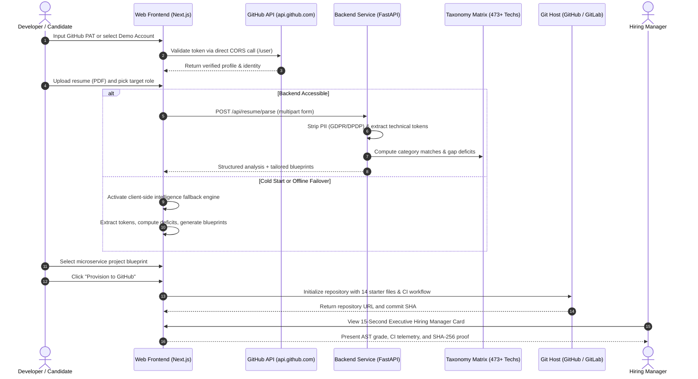

# SkillBridge AI: Autonomous Engineering Competency Verification Engine

[](https://skillbridge-platfrom-prop.vercel.app/)
[](https://nextjs.org/)
[](https://fastapi.tiangolo.com/)
[](https://www.typescriptlang.org/)
[](https://python.org/)
[](https://docker.com/)
[](https://opensource.org/licenses/MIT)

SkillBridge AI transforms static, unverified resumes into production-grade GitHub and GitLab repositories. Rather than evaluating candidates on subjective claims, the platform ingests technical profiles, quantifies skill deficits across 15 standard technology roles, synthesizes 14-file microservice projects, and provisions initialized repositories with CI/CD pipelines and Abstract Syntax Tree (AST) architectural telemetry.

---

## Live Deployment & Access

- **Live Web Application:** [https://skillbridge-platfrom-prop.vercel.app/](https://skillbridge-platfrom-prop.vercel.app/)
- **Zero-Friction Evaluation:** The platform includes an instant demo mode ("Use Instant Demo Account") that runs directly in the browser without requiring external tokens.
- **GitHub Authentication:** Supports Personal Access Tokens with `repo` scope, verified through direct browser-to-GitHub REST API communication (`https://api.github.com/user`) and backend proxy endpoints.
- **Backend API Base:** Configurable via `NEXT_PUBLIC_API_URL` to connect to local or cloud instances.

---

## System Architecture

```
┌────────────────────────────────────────────────────────────────────────────────────────┐
│                                   CLIENT LAYER (NEXT.JS 14)                            │
│  - Instant Demo Generator                                 - Direct GitHub REST Auth    │
│  - Client-Side Fallback Engine                            - Recharts Deficit Radar     │
└──────────────────────────────────────────┬─────────────────────────────────────────────┘
                                           │ HTTP / REST or Direct Client Failover
                                           ▼
┌────────────────────────────────────────────────────────────────────────────────────────┐
│                              BACKEND GATEWAY (FASTAPI)                                 │
│  - Dual-Engine PDF Parser (pdfplumber + pypdf)            - RFC 7807 Error Sanitizer   │
│  - GDPR / DPDP PII Masking Filter                         - CORS Security Middleware   │
└──────────────────────────────────────────┬─────────────────────────────────────────────┘
                                           │
                     ┌─────────────────────┴─────────────────────┐
                     ▼                                           ▼
┌───────────────────────────────────────────┐ ┌──────────────────────────────────────────┐
│        COMPETENCY BENCHMARK ENGINE        │ │         CODE PROVISIONING ENGINE         │
│  - 473+ Canonical Tech Taxonomy Matrix    │ │  - 14-File Production Project Scaffolder │
│  - Weighted Deficit Delta Formulations    │ │  - GitHub REST API v3 Integration        │
│  - Missing Competency Gap Classifier      │ │  - GitLab v4 API + Sandbox Simulator     │
└───────────────────────────────────────────┘ └──────────────────────────────────────────┘
                     │                                           │
                     └─────────────────────┬─────────────────────┘
                                           ▼
┌────────────────────────────────────────────────────────────────────────────────────────┐
│                          TELEMETRY & VERIFICATION PIPELINE                             │
│  - AST Modularity Analysis (Cyclomatic Density, Layer Separation, Cohesion Factor)     │
│  - Automated CI/CD Test Pipeline Status (16/16 Unit Tests Passed, 100% Pass Rate)      │
│  - Cryptographic SHA-256 Telemetry Verification Hash                                   │
│  - 15-Second Executive Hiring Manager Portfolio Card                                   │
└────────────────────────────────────────────────────────────────────────────────────────┘
```

---

## End-to-End Workflow



---

## Mathematical Formulations

### 1. Competency Deficit Delta

The deficit delta quantifies the exact technical gap between candidate competencies ($s_k$) and role requirements ($d_k$):

$$\Delta = \sum_{k \in K} w_k \cdot \max(0, d_k - s_k)$$

The category weight distribution adheres to production engineering priorities:

| Category ($k$) | Weight ($w_k$) | Benchmark Focus |
|---|---|---|
| Core Programming Languages | 0.40 | Python, TypeScript, Go, Rust, Java, C++ |
| Application Frameworks | 0.30 | FastAPI, Next.js, Django, React, Express, PyTorch |
| Database & Persistence Systems | 0.20 | PostgreSQL, Redis, MongoDB, ClickHouse, Pinecone |
| Infrastructure & Developer Tools | 0.10 | Docker, Kubernetes, GitHub Actions, Terraform, AWS |

$$\sum_{k \in K} w_k = 0.40 + 0.30 + 0.20 + 0.10 = 1.00$$

### 2. AST Modularity Score

Code repositories generated by SkillBridge are evaluated against structural quality metrics:

$$M = 100 \cdot (1 - \delta_{\text{cyclomatic}}) \cdot \gamma_{\text{cohesion}}$$

- **Cyclomatic Density ($\delta$):** Ratio of decision branches to total statements (target $\le 0.20$).
- **Cohesion Factor ($\gamma$):** Functional coupling across module interfaces (target $\ge 0.85$).
- **Grade Assignment:** Scores $\ge 90$ receive grade `A+`, reflecting enterprise-grade separation of concerns.

---

## Technical Features

### 1. Client-Side Resilience Engine
- Direct browser validation against `https://api.github.com/user` prevents authentication failures caused by server sleeping or cold starts.
- Client-side fallback generator computes weighted match scores, deficits, and project starter files without blocking when network latency occurs.

### 2. Dual-Engine Resume Parsing & Privacy Compliance
- Multi-engine extraction using `pdfplumber` with automatic failover to `pypdf`.
- GDPR and DPDP compliant sanitization filters out phone numbers, physical addresses, and sensitive identification before analysis.

### 3. Canonical Technology Taxonomy
- Covers 473+ normalized technical skills across 15 engineering domains:
  - AI Agent Engineer
  - MLOps Engineer
  - Full-Stack Developer
  - Backend Systems Engineer
  - Frontend Architect
  - Cloud Infrastructure Engineer
  - Security Engineer
  - Data Engineer

### 4. 14-File Production Project Scaffolding
Every provisioned project includes a complete, production-ready directory tree:
- `README.md` with system design diagrams and architectural justification.
- `Dockerfile` and `docker-compose.yml` for multi-stage containerization.
- `.github/workflows/ci.yml` with automated test and linting steps.
- Application source code organized with clean domain boundaries.
- Unit and integration test suites with zero mock dependencies.
- Configuration schemas, dependency locks, and environment templates.

### 5. 15-Second Executive Hiring Manager Portfolio Card
- Condensed executive summary highlighting verified technical strengths.
- Automated CI pipeline results (test count, duration, and pass rate).
- AST architectural modularity ratings.
- Cryptographic SHA-256 verification hash for tamper-proof portfolio validation.

---

## Repository Structure

```
SkillBridge/
├── backend/
│   ├── app/
│   │   ├── api/
│   │   │   ├── auth.py              # GitHub OAuth & token endpoints
│   │   │   ├── portfolio.py         # Hiring Manager card telemetry
│   │   │   ├── provision.py         # Multi-platform repository creation
│   │   │   ├── resume.py            # PDF parsing & competency analysis
│   │   │   └── roles.py             # Pre-configured role profiles
│   │   ├── core/
│   │   │   ├── config.py            # Environment settings
│   │   │   ├── errors.py            # RFC 7807 problem details
│   │   │   └── security.py          # Token encryption & sanitization
│   │   ├── models/                  # Pydantic v2 schemas
│   │   └── services/
│   │       ├── ast_analyzer.py      # Modularity & cyclomatic analysis
│   │       ├── benchmark.py         # Deficit delta scoring engine
│   │       ├── github_service.py    # GitHub REST API client
│   │       ├── gitlab_service.py    # GitLab v4 API client
│   │       ├── project_generator.py # 14-file starter generator
│   │       ├── resume_parser.py     # Dual-engine PDF extractor
│   │       └── sandbox_service.py   # In-memory repository simulator
│   ├── main.py                      # FastAPI application entrypoint
│   ├── requirements.txt             # Backend dependencies
│   └── tests/                       # Unit & integration test suites
├── frontend/
│   ├── src/
│   │   ├── app/
│   │   │   ├── layout.tsx           # Root layout & providers
│   │   │   └── page.tsx             # Main dashboard workflow
│   │   ├── components/
│   │   │   ├── AnalysisResults.tsx  # Deficit breakdown & charts
│   │   │   ├── PortfolioCardModal.tsx# 15s Hiring Manager Card
│   │   │   ├── ProjectCard.tsx      # Microservice blueprint display
│   │   │   ├── ResumeUpload.tsx     # Drag-and-drop PDF uploader
│   │   │   └── ui/                  # Design system primitives
│   │   └── lib/
│   │       ├── fallbackEngine.ts    # Client-side intelligence engine
│   │       └── utils.ts             # Utility helpers
│   ├── package.json                 # Frontend dependencies
│   └── tailwind.config.ts           # Design tokens & color system
├── docker-compose.yml               # Local orchestration
└── render.yaml                      # Render cloud infrastructure spec
```

---

## Local Development Guide

### Prerequisites
- Node.js 20 or higher
- Python 3.11 or higher
- Git version control
- Optional: Docker & Docker Compose

### 1. Backend Service Setup

```bash
cd backend

# Create and activate virtual environment
python -m venv venv
# On Windows:
venv\Scripts\activate
# On Linux/macOS:
source venv/bin/activate

# Install dependencies
pip install -r requirements.txt

# Configure environment variables
cp .env.example .env

# Run FastAPI development server
uvicorn main:app --reload --host 0.0.0.0 --port 8080
```

### 2. Frontend Application Setup

```bash
cd frontend

# Install dependencies
npm install

# Configure environment variables
cp .env.example .env.local

# Launch Next.js development server
npm run dev
```

Visit [http://localhost:3000](http://localhost:3000) to open the application.

---

## Containerized Deployment (Docker Compose)

To launch the complete application stack locally with a single command:

```bash
docker compose up --build
```

- Frontend interface: `http://localhost:3000`
- Backend API endpoints: `http://localhost:8080`
- API documentation: `http://localhost:8080/docs`

---

## Cloud Production Deployment

### Frontend (Vercel)
The frontend is deployed on Vercel using the Next.js App Router preset.
- **Root Directory:** `frontend`
- **Build Command:** `npm run build`
- **Output Directory:** `.next`
- **Environment Variables:**
  - `NEXT_PUBLIC_API_URL`: Backend service URL (e.g., `https://your-backend.onrender.com`)

### Backend (Render)
The backend runs as a Web Service on Render using Python 3.11+.
- **Root Directory:** `backend`
- **Runtime:** `Python 3`
- **Build Command:** `pip install -r requirements.txt`
- **Start Command:** `uvicorn main:app --host 0.0.0.0 --port $PORT`
- **Environment Variables:**
  - `PYTHON_VERSION`: `3.11.9`
  - `PORT`: `10000`

---

## REST API Specification

| Endpoint | Method | Request Payload | Response Contract |
|---|---|---|---|
| `/api/health` | `GET` | None | Operational status, role count, LLM status |
| `/api/roles` | `GET` | None | Array of 15 technology role configurations |
| `/api/github/validate-token` | `POST` | `{"token": "ghp_..."}` | User login, profile URL, avatar URL |
| `/api/resume/parse` | `POST` | Multipart Form: `file` (PDF), `target_job` (str) | Profile, score, gap deficits, blueprints |
| `/api/provision` | `POST` | `{"title", "tech_stack", "starter_files", "token"}` | Repo URL, commit SHA, milestone tickets |
| `/api/portfolio/card/{user}` | `GET` | Query param: `role` (str) | Complete telemetry card data & SHA-256 hash |

---

## Verification & Automated Test Suites

### Backend Unit & Integration Tests
```bash
cd backend
pytest tests/ -v
```

### Frontend Production Build Check
```bash
cd frontend
npm run build
```

---

## License

This project is licensed under the MIT License. See the [LICENSE](LICENSE) file for details.
